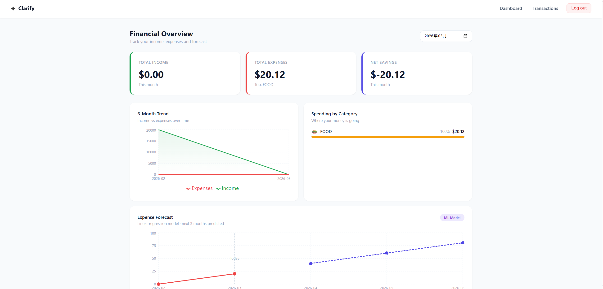
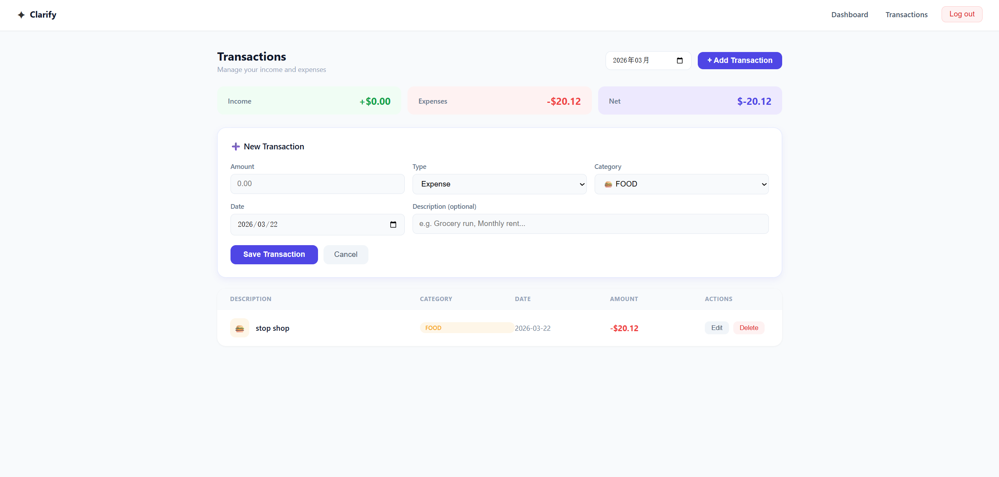
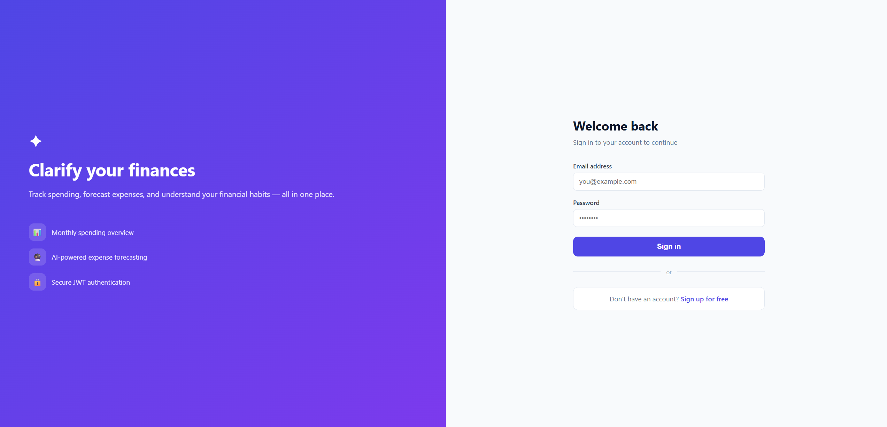
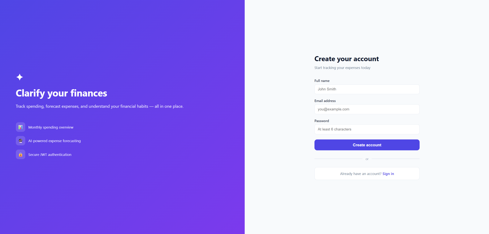

# Clarify — Frontend
🌐 **Live Demo**: https://clarify-frontend-production.up.railway.app

> React + TypeScript frontend for Clarify, a personal finance app with dashboard analytics, transaction management, real-time budget alerts and ML-powered expense forecasting.

## Tech Stack

| Layer | Technology |
|---|---|
| Language | TypeScript (strict) |
| Framework | React 19 |
| Build tool | Vite |
| Routing | React Router v7 |
| HTTP Client | Axios |
| Charts | Recharts |
| Real-time | Native WebSocket |
| Styling | CSS-in-JS (inline styles) |

## Features

- **Authentication** — Email/password and Google sign-in, with field-level error messages
- **Dashboard** — Monthly income/expense summary, category breakdown, 6-month area chart
- **Transactions** — Add, edit, delete, filter by month; server validation errors shown next to each field
- **Expense Forecast** — Historical expenses next to predicted future spending
- **Budget Alerts** — Toasts pushed by the server when a category goes over budget
- **Protected Routes** — Redirect to login when the token is missing or expired

## Screenshots

> Dashboard


> Transactions


> Login


> Sign up


## Getting Started

### Prerequisites
- Node.js 20.19+ (or 22.12+)
- A Clarify backend on `http://localhost:8080` — either the Python/FastAPI or the Java/Spring Boot one; both implement the same API

### Run locally

```bash
npm install
npm run dev        # or: npm start
```

The app opens at `http://localhost:3000`.

### Scripts

| Command | What it does |
|---|---|
| `npm run dev` | Dev server with hot reload |
| `npm run build` | Type-check, then build to `dist/` |
| `npm run preview` | Serve the production build locally |
| `npm run typecheck` | Type-check only |

### Configuration

Vite reads `.env` files at build time; only variables prefixed `VITE_` reach the browser.

| Variable | Where | Purpose |
|---|---|---|
| `VITE_API_URL` | `.env` (dev), `.env.production` | Backend base URL. The WebSocket URL is derived from it (`http→ws`, `https→wss`). |
| `VITE_GOOGLE_CLIENT_ID` | `.env` | Google OAuth client ID. Leave empty to hide the Google button. |

Put machine-specific overrides in `.env.local` (git-ignored).

### Deploying

The build output is a static site in `dist/`. Serve it with SPA fallback (unknown paths → `index.html`) so routes like `/dashboard` survive a refresh.

## Project Structure

```
src/
├── api/client.ts            → Typed API calls, JWT + 401 interceptors
├── auth/
│   ├── AuthContext.tsx      → Session state (sign in / sign out)
│   └── token.ts             → Token storage and decoding
├── hooks/
│   ├── useBudgetAlerts.ts   → WebSocket connection + alert queue
│   └── useIsMobile.ts
├── components/
│   ├── Navbar.tsx
│   └── BudgetAlertToast.tsx
├── pages/
│   ├── LoginPage.tsx
│   ├── DashboardPage.tsx
│   └── TransactionsPage.tsx
├── lib/dates.ts             → Local-time month/date helpers
├── categories.ts            → Category colors and icons
├── types/index.ts           → API types
├── config.ts                → Env-based configuration
├── App.tsx                  → Routes and protected route logic
└── main.tsx                 → Entry point
```


## Backend

- Python / FastAPI: `clarify-python`
- Java / Spring Boot: `clarify-backend-java`

